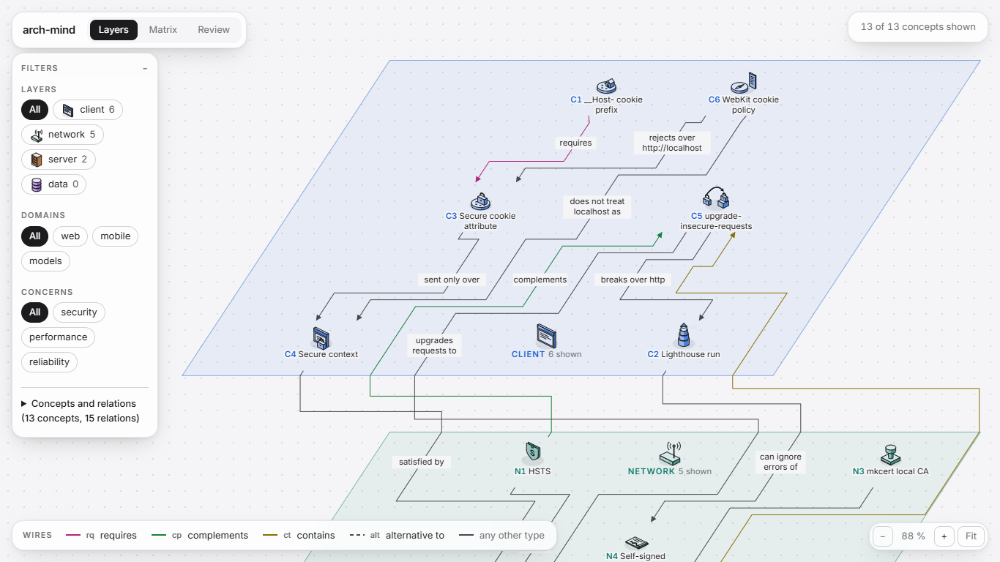
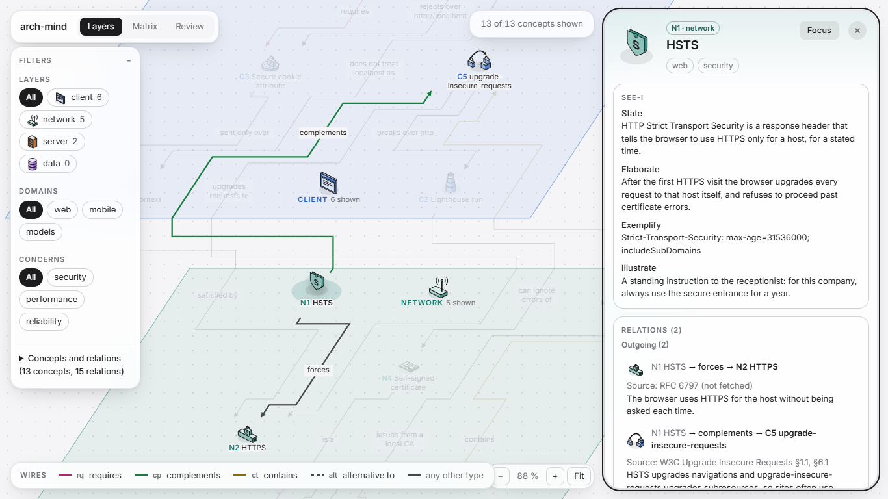

# arch-mind

Capture the architecture concepts that come up while you work with Claude Code, see how they relate across system layers, and review them until you can explain them from memory.



An answer from Claude about, say, why a `__Host-` cookie fails over `http://localhost` makes sense in the moment and is gone a week later. arch-mind keeps it:

- **Capture inside Claude Code.** A Claude Code plugin proposes the concept, its relations to concepts you already have, a SEE-I draft (State, Elaborate, Exemplify, Illustrate), a pictogram, an optional SVG illustration and recall questions. Nothing is saved until you confirm, edit or rewrite each part, and every relation carries its source and your own one-sentence explanation.
- **Study in small views.** A local web app shows concepts on stacked layer plates (client, network, server, data) or in a matrix, filtered by layer, domain and concern, with a finder, a focus mode and a grouped-by-domain view for when a view gets too big.
- **Review on a schedule.** A daily Leitner review asks each recall question and hides the answer until you have tried to remember it.
- **Own your notes.** The store is a folder of plain Markdown files, readable and editable without arch-mind.



## Requirements

- [Node.js](https://nodejs.org/) 24 or later
- [pnpm](https://pnpm.io/) 11 (`corepack enable` installs the version pinned in `package.json`)
- [Claude Code](https://code.claude.com/), for capturing
- A desktop browser; the views are designed for a window at least 1366 px wide

arch-mind was developed and tested on Windows 11. The code also handles macOS and Linux, but they have not been tested.

## Install

```bash
git clone https://github.com/sue-btis/arch-mind.git
cd arch-mind
corepack enable
pnpm install
pnpm build
```

The build is required: the Claude Code plugin and the web app both run from the built `dist/` folders, which are not committed.

## Set up your store

Create the folder that will hold your concepts (any new folder path):

```bash
node packages/server/dist/cli.mjs setup /path/to/arch-mind-store
```

This creates `concepts/`, `facets.yaml` and `reviews.jsonl` in that folder and records its path in `~/.arch-mind/config.json`. Keep the store on a local disk: saves use hard links, which FAT32/exFAT drives and some network or sync drives do not support. Back it up, for example as its own Git repository.

The allowed domains and concerns are the lists in `facets.yaml`; edit them to fit what you study.

## Capture a concept

Install the plugin once from your clone; the repository is its own plugin marketplace:

```bash
claude plugin marketplace add /path/to/arch-mind
claude plugin install arch-mind@arch-mind
```

From then on every Claude Code session loads it, in any project. Add the marketplace from the local folder, not from GitHub: a local marketplace loads the plugin in place, with the `dist/` you built, while a GitHub install would clone the repository without it. After pulling changes and running `pnpm build` again, start a new session (or run `/reload-plugins`).

To try it for one session without installing, use `claude --plugin-dir /path/to/arch-mind/packages/capture` instead.

When a concept comes up, ask Claude to capture it, for example *"capture the `__Host-` cookie prefix as a concept"*. The `capture-concept` skill then:

1. reads your existing concepts and the allowed domains, concerns and pictograms;
2. proposes an id, title, layer, facets, relations with sources, a SEE-I draft, a pictogram and recall questions;
3. if the illustration describes something drawable, drafts an SVG and opens a preview in your browser;
4. saves only what you confirmed.

To add relations, episodes or questions to a concept you already have, ask Claude to extend it.

The plugin's MCP server exposes `list_concepts`, `get_concept`, `save_concept`, `extend_concept` and `preview_illustration`. Claude Code asks for permission the first time each one runs; you can allow them permanently from that prompt. Capture works whether or not the web app is running.

## Study and review

```bash
node packages/server/dist/cli.mjs
```

Open http://127.0.0.1:4417.

- **Layers**: concepts on their layer plates with their relations. Filter by layer, domain and concern; press `Ctrl K` to find a concept; select one to open its drawer (SEE-I, relations with sources, episodes, recall questions). When a view would not fit, narrow the filters, focus on one concept and its neighbours, or group by domain.
- **Matrix**: the shown concepts in a concept × concept grid, ordered by layer; each cell holds the relations from the row's concept to the column's.
- **Review**: the questions due today. Try to answer, reveal the answer with `Space`, then mark it Wrong (`1`) or Right (`2`); a right answer moves the question up one Leitner box, a wrong one sends it back to the first. After a wrong answer, **Open concept** shows its full detail.

The server listens on `127.0.0.1` only, so no other device can reach it.

## The store

```
arch-mind-store/
├── concepts/            one Markdown file per concept (front matter + SEE-I)
├── illustrations/       <concept-id>.svg, when a concept has an illustration
├── facets.yaml          allowed domains and concerns, Leitner intervals
└── reviews.jsonl        append-only review history
```

Illustrations are checked against a strict SVG allowlist when saved and again when loaded (no scripts, event handlers, external references, `<style>` or malformed XML), and the app serves them with a restrictive Content-Security-Policy.

## Development

```bash
pnpm typecheck
pnpm lint
pnpm test
pnpm build
```

The browser end-to-end tests in `packages/server/test/*.e2e.test.ts` drive an installed Google Chrome through Playwright.

The workspace has four packages:

| Package | Role |
|---|---|
| `packages/rules` | The store and every domain rule: concept validation, the SVG allowlist, the Leitner schedule |
| `packages/capture` | The Claude Code plugin: MCP server, `capture-concept` skill, illustration preview |
| `packages/server` | The `arch-mind` command: store setup and the local HTTP server |
| `packages/ui` | The React web app (Vite, React Flow, elkjs, Tailwind CSS) |

The product and design documents live in `docs/`: the brief and PRD in `docs/product/`, the architecture decisions (ADRs), domain model and quality attributes in `docs/design/`, and the milestone plan in `docs/build/plan.md`. The per-change working records that some of these documents cite are not published.

## Status

arch-mind 0.1 is a personal, single-user tool and the planned milestones are complete. Still open: the Leitner box count and intervals are a provisional default (`facets.yaml`, `leitnerIntervalsDays`), and the plugin installs only from a local, built clone, not directly from GitHub.

## License

[MIT](LICENSE)
