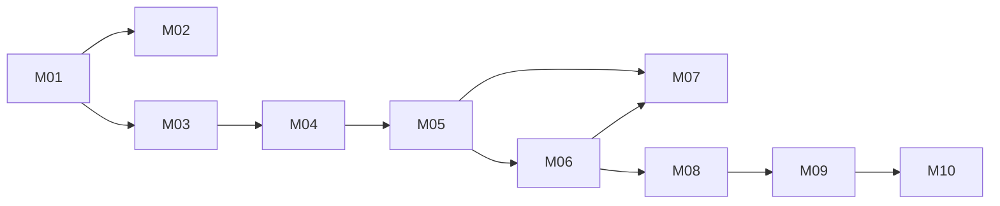

# arch-mind Build Plan

Baseline: RV-003 (M01 to M04 were planned and built against RV-001; Phase 2 milestones M05 to M07 plan against RV-002; Phase 3 milestones M08 to M10 plan against RV-003)
Change folders: docs/changes/; milestone folders are named YYYY-MM-DD-Mxx-<slug>

Milestone status (no status is stored in this plan):

```bash
grep -iH -m4 -E '^(Verdict|Acceptance|Verified by|Open limitations):' docs/changes/*-[Mm][0-9]*-*/verification.md
```

Changes since approval: the repository was not under version control when the design was approved, so later changes to `docs/product` and `docs/design` cannot be listed from git until it is. Once it is, use `git log -1 --format=%H -S'status: approved' -- docs/spec/manifest.yaml` and `git log --oneline <sha>.. -- docs/product docs/design`.

## Strategy
Four vertical slices, each usable on its own. The riskiest assumptions are proved first, in M01:
- a concept captured from Claude Code with the app closed is written by the shared rules module and then shown by the local server (ADR-001, ADR-003, ADR-004);
- the layer view with stacked bands fits the reference screen with real data (ADR-006, NFR-001);
- the local port rejects foreign Host and Origin (ADR-005).

M02 and M03 then grow capture and views independently; M04 adds review on top of the concept detail from M03.

Phase 2 (PRD §12) adds three slices. M05 proves the riskiest Phase 2 assumption first: the own SVG plates renderer (ADR-008) draws the TST-032 chain at the reference width with a Fit scale of at least 0.85, with pictograms from the library and the layer pictogram as fallback. M06 then makes the map respond to selection with the relation drawer, which answers the P0 finding of the 2026-11-01 UX critique. M07 adds the pictogram and illustration proposals to capture (ADR-009). Order M06 before M07: author, 2026-11-01, «Selection first (Recommended)».

Phase 3 (PRD §12) adds three slices, built before M07: author, 2026-11-01, «Fase 3 primero (Recommended)». Nothing external blocks them, while M07 waits on the author's timed captures. The cut into three is the author's, «Sí, M08–M10 (Recommended)». M08 delivers the finder and the legend type filter, the smallest slice that most improves daily use. M09 adds focus and searchable facet filters and makes the would-not-fit message offer narrower filters or focus, from the layer view and the matrix. M10 adds the grouped layer view. It starts with the ADR-010 probe of elk compound nodes on layer partitions, the riskiest Phase 3 assumption, and falls back to a graph of group nodes if the probe fails.

## Architecture Proof Slice
Milestone: M01
Why this is the smallest useful end-to-end proof:
- It crosses every container in `architecture.dsl` once: capture server, rules module, concept files, local server, Study UI.
- It tests the one-way decisions early: the file format (ADR-002) and the language and shared rules module (ADR-004).
- It measures NFR-001 with the elkjs version the project pins, which discovery measured only with an older one.

## Dependency Graph

M07 depends on M05 for the pictogram catalog and on M06 for the drawer that shows the illustration. M08 builds on the M06 selection; M09 reuses the M08 finder to pick a concept to focus on; M10 adds the third way out to the M09 message.

## Milestone M01 — A concept captured from Claude Code appears in the layer view

Goal:
With arch-mind closed, the author saves a complete concept (SEE-I, facets, one relation with a source, one recall question) through the capture plugin. Then the author starts the arch-mind command and sees that concept, and the concept it relates to, in the layer view, inside a 1366 px wide window.

Requirements:
- FR-001, FR-005, FR-033, FR-006, FR-009, FR-010, FR-011, FR-013, FR-014, FR-015, FR-019, FR-020
- NFR-001, NFR-003, NFR-004, NFR-005
- BR-001, BR-002, BR-003, BR-005
- CON-001, CON-002, CON-004, CON-005

Canonical authorities:
- `docs/design/domain.md`
- `docs/design/architecture/architecture.dsl`
- `docs/design/architecture/adr/` (ADR-001 to ADR-007)
- `docs/design/architecture/quality-attributes.md`
- `docs/design/data/concept.schema.json`, `docs/design/data/facets.schema.json`
- `docs/design/api/capture-tools.schema.json` (`list_concepts`, `save_concept`)
- `docs/design/api/openapi.yaml` (`GET /api/concepts`, `GET /api/facets`)
- `docs/design/ux/flows.mmd`

Prerequisites:
- None. The repository is created in this milestone (git initialized, work on a `feat/...` branch per the author's convention).

Expected create/edit areas (proposed, nothing exists yet):
- a shared rules package (parse, validate, serialize concept files; atomic write);
- the capture plugin (manifest, capture skill, stdio MCP server with `list_concepts` and `save_concept`);
- the local server (request guard, `GET /api/concepts`, `GET /api/facets`, static UI);
- the Study UI (layer view only: elkjs layout, React Flow drawing);
- workspace configuration (TypeScript, test runner, lint).

Acceptance:
- AC-001 — `save_concept` with a valid concept writes one Markdown file whose frontmatter and SEE-I headings match `concept.schema.json`; reading it back through the rules module returns an equal object.
- AC-002 — `save_concept` with a relation without a source, a relation to a missing concept, or an existing id writes nothing and returns a rejection whose `path` and `rule` name the problem (`missing_source`, `missing_target`, `duplicate_id`).
- AC-003 — The capture succeeds while the local server is not running.
- AC-004 — After starting the arch-mind command, the layer view shows the saved concepts in the bands of their layers, stacked client, network, server, data, with each relation drawn as an arrow labeled with its type.
- AC-005 — The TST-032 chain (13 concepts, 15 relations, entered as fixtures) renders as a layer view with no horizontal scrollbar in a 1366 × 768 window at 100 % zoom.
- AC-006 — A request to the local server with a foreign Host, or with a foreign Origin, is rejected; from another device on the network, no arch-mind port answers.
- AC-007 — A saved concept file opened in a plain text editor shows readable SEE-I, relations with sources and recall questions.

Tests:
- TST-001 — Rules module round trip: serialize then parse a concept with every optional field; objects are equal (AC-001).
- TST-002 — Rules module rejects each of: missing source, missing target, duplicate id, missing SEE-I part, no recall question, layer outside the fixed list; each rejection carries the expected `path` and `rule` (AC-002).
- TST-003 — Capture server contract test: drive the stdio server with `tools/list` and `tools/call` and validate every result against `capture-tools.schema.json` (AC-001, AC-002).
- TST-004 — Atomic write: interrupt a save between the temporary write and the rename; the store holds either the old file or the new one, never a partial file (NFR-003).
- TST-005 — Architecture rule "Only the rules module parses or validates concept files": a dependency check fails if any other package imports the YAML parser.
- TST-006 — Architecture rule "The Study UI and local server never write concept files": the local server has no write path to the concepts folder.
- TST-007 — Architecture rule "The local server listens on 127.0.0.1 and passes every request through the guard": requests with foreign Host and foreign Origin get 403; non-JSON bodies get 415 (AC-006).
- TST-008 — Layer view width: render the TST-032 fixture at 1366 px and assert no horizontal overflow (AC-005, NFR-001).

Quality gates:
- type check, lint and the test runner chosen in this milestone pass with no errors;
- `node <reviewing-system-design>/scripts/check-package.mjs .` still passes.

Completion evidence:
- test output for TST-001 to TST-008;
- a screenshot of the layer view with the TST-032 fixture at 1366 × 768;
- the saved concept file from AC-007;
- one interactive capture in a normal Claude Code session, noting whether `save_concept` asked for permission by default (open in `docs/discovery/findings.md` DQ-006).

Stop if:
- implementation requires changing a frozen product behavior;
- canonical authorities contradict each other;
- an unapproved architecture decision is required;
- required scope expands beyond this milestone;
- F-006 is still open when both processes need the store path: the single configuration source of the store folder must first be named in `architecture.dsl` through this milestone's change folder (Canonical Design Impact);
- PD-017 is still open and the capture flow needs to add new domains or concerns: keep the facet catalog read-only for capture, as designed;
- the author has not confirmed the store folder is backed up (human task from `quality-attributes.md` Operations), before the first real concept is captured.

## Milestone M02 — Claude proposes, the author builds the concept

Goal:
In a Claude Code session, Claude proposes candidate relations with sources, a SEE-I draft and recall questions; the author selects, explains, accepts or rewrites each, and saves. The author can later add relations, questions or an episode to an existing concept.

Requirements:
- FR-002, FR-003, FR-004, FR-007, FR-008, FR-012
- NFR-002
- BR-004

Canonical authorities:
- `docs/design/api/capture-tools.schema.json` (`get_concept`, `extend_concept`, rejection)
- `docs/design/ux/flows.mmd`
- `docs/design/data/concept.schema.json`
- `docs/design/architecture/adr/ADR-003-capture-path.md`

Prerequisites:
- M01

Expected create/edit areas (proposed):
- capture skill instructions (proposal and confirmation steps);
- capture server: `get_concept`, `extend_concept`;
- rules module: additive merge with duplicate-relation check.

Acceptance:
- AC-008 — During a capture, every proposed relation shows a type, a target and a source, and only the relations the author selected are saved, each with the author's explanation.
- AC-009 — A SEE-I part or recall question the author did not accept, edit or rewrite is not saved.
- AC-010 — `extend_concept` adds a relation, a recall question or an episode to an existing concept; new recall ids continue after the highest stored q-number and carry today's local date as `confirmed`; a duplicate (type, to) is rejected as `duplicate_relation`; fields outside the additive set are rejected.
- AC-011 — Over 5 real captures with up to 3 relations each, the tool adds at most 60 seconds of waiting and at most 2 confirmation prompts per capture, excluding the author's writing time (NFR-002).

Tests:
- TST-009 — Contract test for `get_concept` and `extend_concept` against `capture-tools.schema.json`, including `nothing_to_add`, `unknown_concept` and `duplicate_relation` rejections (AC-010).
- TST-010 — Rules module merge: extending never changes stored fields and assigns recall ids after the current highest (AC-010).
- TST-011 — Recorded skill walk-through: a scripted capture transcript where the author rejects one proposed relation and rewrites one SEE-I part; the saved file contains only what was confirmed (AC-008, AC-009).

Quality gates:
- type check, lint, tests pass; package check passes.

Completion evidence:
- test output for TST-009 to TST-011;
- a timing log of the 5 captures for AC-011.

Stop if:
- implementation requires changing a frozen product behavior;
- canonical authorities contradict each other;
- an unapproved architecture decision is required;
- required scope expands beyond this milestone;
- PD-017 is still open and the capture flow needs to add new domains or concerns.

## Milestone M03 — Study views over facet filters

Goal:
The author filters by domains, layers and concerns, follows chains in the layer view, checks every relation in the matrix view, sees sources and explanations on hover, opens a concept's detail, and sees hand edits and broken files reported.

Requirements:
- FR-016, FR-017, FR-018, FR-021, FR-022, FR-023, FR-024, FR-025
- UX-001, UX-003

Canonical authorities:
- `docs/design/api/openapi.yaml` (`GET /api/concepts`, `GET /api/concepts/{id}`, `GET /api/facets`)
- `docs/design/architecture/adr/ADR-006-layer-view-layout.md`
- `docs/design/domain.md` (View, Layer view, Matrix view, Reference screen)

Prerequisites:
- M01

Expected create/edit areas (proposed):
- Study UI: filters, matrix view, hover details, concept detail, problems list;
- local server: `GET /api/concepts/{id}`, problems in `GET /api/concepts`.

Acceptance:
- AC-012 — Any combination of domain, layer and concern filters selects exactly the matching concepts in both views.
- AC-013 — The matrix view shows matching concepts as rows and columns with the relation type in the source-row, target-column cell.
- AC-014 — Hovering or tapping a relation in either view shows its source and the author's explanation.
- AC-015 — When the matching concepts would not fit 1366 px wide, the app says so and suggests narrower filters instead of drawing a view that scrolls sideways.
- AC-016 — Selecting a concept opens its detail with SEE-I, relations with sources and explanations, episode, facets and the review state of each question.
- AC-017 — A hand edit to a concept file appears on the next load; a broken file is listed with its name and reason.

Tests:
- TST-012 — Filter selection unit tests over a fixture store (AC-012).
- TST-013 — Matrix rendering test on the TST-032 fixture (AC-013).
- TST-014 — Width guard: a fixture that cannot fit triggers the message, not a scrolling view (AC-015).
- TST-015 — API contract test for `GET /api/concepts/{id}` and the `problems` list against `openapi.yaml` (AC-016, AC-017).

Quality gates:
- type check, lint, tests pass; package check passes.

Completion evidence:
- test output for TST-012 to TST-015;
- screenshots of both views and the concept detail at 1366 × 768.

Stop if:
- implementation requires changing a frozen product behavior;
- canonical authorities contradict each other;
- an unapproved architecture decision is required;
- required scope expands beyond this milestone.

## Milestone M04 — Daily Leitner review

Goal:
The author opens the review screen, answers each due question from memory before seeing the answer, marks right or wrong, and the question moves between Leitner boxes. After a wrong answer the app offers the concept's detail. History is never rewritten.

Requirements:
- FR-026, FR-027, FR-028, FR-029, FR-030, FR-031, FR-032
- NFR-006
- BR-006, BR-007
- UX-002

Canonical authorities:
- `docs/design/api/openapi.yaml` (`GET /api/reviews/due`, `POST /api/reviews`)
- `docs/design/data/review-line.schema.json`, `docs/design/data/facets.schema.json`
- `docs/design/ux/review-flow.mmd`
- `docs/design/architecture/adr/ADR-002-storage-format.md`

Prerequisites:
- M03 (FR-031 opens the concept detail built there)

Expected create/edit areas (proposed):
- local server: Leitner scheduler, review endpoints, append-only log writer;
- Study UI: review screen.

Acceptance:
- AC-018 — The review screen lists the questions due on the current local day.
- AC-019 — The answer (SEE-I and explanations) stays hidden until the author reveals it, then the author marks right or wrong.
- AC-020 — A right answer moves the question up one box (stopping at the last) and sets the next due date by that box's interval; a wrong answer returns it to box 1; a new question is due the day after its `confirmed` day.
- AC-021 — After a wrong answer, the app offers the concept's detail.
- AC-022 — Each review appends one line to the log; no earlier line is ever changed.
- AC-023 — With 300 concepts, 600 questions and a year of review lines, the due list appears within 2 seconds of opening (NFR-006).

Tests:
- TST-016 — Architecture rule "Box and due date are never stored": scheduler tests replay known histories from `confirmed`, including a question with no reviews (AC-020).
- TST-017 — Architecture rule "The review log is only appended": the log writer opens the file in append mode only and a test asserts earlier lines are byte-identical after new reviews (AC-022).
- TST-018 — API contract test for the review endpoints against `openapi.yaml` (AC-018, AC-020).
- TST-019 — Load test with generated data for AC-023.
- TST-020 — UI test: the answer is not in the document before reveal (AC-019).

Quality gates:
- type check, lint, tests pass; package check passes.

Completion evidence:
- test output for TST-016 to TST-020, including the load-test timing.

Stop if:
- implementation requires changing a frozen product behavior;
- canonical authorities contradict each other;
- an unapproved architecture decision is required;
- required scope expands beyond this milestone;
- PD-016 is still open: read the box count and intervals from `facets.yaml`, never hard-code them;
- F-005 is still open when the scheduler compares dates: the day-boundary rule (local time zone, due date ≤ today) must first be stated in `domain.md` through this milestone's change folder;
- F-004 is still open when assigning recall ids after hand edits: either record the limitation as accepted or name the prevention rule in the design first.

## Milestone M05 — Layer plates with pictograms

Goal:
At 1366 × 768 the layer view shows the four layers as stacked isometric plates, each with its layer pictogram, and every matching concept as its pictogram (its own, or its layer's when it has none or an unknown id) with designator and short title, typed wires between them, zoom in and Fit; the TST-032 chain fits at a Fit scale of at least 0.85, and a view that would need less is refused with the narrower-filters message.

Requirements:
- FR-019 (as amended), FR-020, FR-023, FR-037, FR-038, FR-042
- NFR-001
- BR-008 (read side)

Canonical authorities:
- `docs/design/architecture/adr/ADR-008-layer-plates-renderer.md` (base sizes, Fit scale, 0.85 floor)
- `docs/design/architecture/adr/ADR-009-pictogram-and-illustration-storage.md` (pictogram field, catalog, load rules)
- `docs/design/data/concept.schema.json` (`pictogram`)
- `docs/design/api/openapi.yaml` (`Concept.pictogram`)
- `docs/design/architecture/quality-attributes.md` (NFR-001 row; rules "No React Flow in the UI", catalog and artwork)
- `DESIGN.md`, PRD UX-001, UX-004

Prerequisites:
- M04

Expected create/edit areas (proposed):
- rules module: pictogram catalog (ids and meanings, four layer ids) and pictogram load rules;
- Study UI: plates renderer replacing the React Flow layer view; pictogram artwork asset, seeded from the isometric set in the reviewed mock;
- `DESIGN.md` re-documented at the end with the plates and pictogram rules.

Acceptance:
- AC-024 — Plates stack in the order client, network, server, data; each concept sits on its layer's plate; each relation is a directed wire labeled with its type (FR-019, FR-020).
- AC-025 — Each layer shows its pictogram; a concept with a catalog pictogram shows it; a concept with none, or with an id not in the catalog, shows its layer's pictogram, and the unknown id is listed in the file problems (FR-037, FR-038, ADR-009).
- AC-026 — At 1366 × 768 the TST-032 chain renders at Fit with scale ≥ 0.85, no horizontal scrolling, labels ≥ 11 px and pictograms ≥ 32 px on screen; a fixture needing a Fit scale below 0.85 shows the narrower-filters message (NFR-001, FR-023, ADR-008).
- AC-027 — The author can zoom in and return to Fit (FR-042).
- AC-028 — Every pictogram is shown with the name it stands for and has a text alternative (UX-004).

Tests:
- TST-021 — Rules: catalog contents (four layer ids) and pictogram load rules, including an unknown id reported in problems (AC-025).
- TST-022 — Layout and projection unit tests: plate order, placement, Fit scale formula and the 0.85 refusal (AC-024, AC-026).
- TST-023 — End-to-end at 1366 × 768, light and dark: TST-032 at Fit with measured scale, no horizontal scroll, label and pictogram sizes; over-wide fixture refused; zoom and Fit (AC-026, AC-027, AC-028). Replaces the React Flow based TST-008 and TST-014 assertions.
- TST-024 — Architecture rule "No React Flow in the UI": `@xyflow/react` is not a UI dependency.
- TST-025 — Architecture rule "catalog and artwork": catalog ids and artwork names are the same set and include the four layer ids.

Quality gates:
- type check, lint, tests pass; package check passes.

Completion evidence:
- TST-021 to TST-025 output; measured Fit scale for TST-032; screenshots light and dark.

Stop if:
- the TST-032 Fit scale is below 0.85 at 1366 px (ADR-008 revisit trigger: report the measurement);
- implementation requires changing a frozen product behavior or an accepted ADR;
- required scope expands beyond this milestone.

## Milestone M06 — Selection and the relation drawer

Goal:
Selecting a concept marks it, keeps its relations and the concepts they connect prominent and makes the rest recede; a drawer beside the view, without hiding the selection, shows the concept's pictogram, SEE-I, episode, facets, review state and its incoming and outgoing relations as source → type → target with source and explanation; choosing the other end selects it; clearing the selection restores the view.

Requirements:
- FR-021, FR-024 (as amended), FR-025 (as amended, without the illustration), FR-039, FR-040, FR-041

Canonical authorities:
- `docs/design/domain.md` (Selection / neighbourhood)
- `docs/design/architecture/adr/ADR-008-layer-plates-renderer.md` (selection on SVG elements, accessible list alternative)
- `docs/design/architecture/architecture.dsl` (StudyUI selection and drawer)
- `docs/design/api/openapi.yaml` (`GET /api/concepts/{id}`)
- PRD UX-004; PRODUCT.md accessibility baseline

Prerequisites:
- M05

Expected create/edit areas (proposed):
- Study UI: selection state, receding of non-neighbours, relation drawer, accessible list of concepts and relations.

Acceptance:
- AC-029 — Selecting a concept marks it; its incoming and outgoing relations and the concepts they connect stay prominent; every other concept and relation recedes but stays identifiable (FR-039).
- AC-030 — The drawer opens beside the view without hiding the selected concept and shows pictogram, SEE-I, episode, facets, review state, and incoming and outgoing relations with source and explanation (FR-024, FR-025, FR-040).
- AC-031 — Choosing the other end of a listed relation selects that concept (FR-040).
- AC-032 — Clearing the selection (Escape or the close control) restores full prominence and returns focus to where it was (FR-041).
- AC-033 — Every concept and relation is reachable and operable by keyboard, through the plates or the accessible list, with visible focus; active text meets WCAG 2.2 AA.

Tests:
- TST-026 — Neighbourhood unit tests: incoming and outgoing relations and connected concepts for a selection, including self-free and cross-layer cases (AC-029, AC-031).
- TST-027 — End-to-end: select, drawer contents, navigate by the other end, clear (AC-029 to AC-032).
- TST-028 — End-to-end keyboard path and accessible list (AC-033).

Quality gates:
- type check, lint, tests pass; package check passes.

Completion evidence:
- TST-026 to TST-028 output; screenshots of a selection with the drawer, light and dark.

Stop if:
- implementation requires changing a frozen product behavior or an accepted ADR;
- required scope expands beyond this milestone.

## Milestone M07 — Capture proposes a pictogram and an illustration

Goal:
In a Claude Code capture, Claude proposes a pictogram from the catalog and, when the illustration part describes a drawable scene, a visual illustration that the author sees in a browser preview; only what the author accepts is saved; an existing concept without them can gain them; the drawer shows the illustration.

Requirements:
- FR-025 (illustration), FR-034, FR-035, FR-036
- NFR-002, NFR-003, NFR-004
- BR-004, BR-008

Canonical authorities:
- `docs/design/api/capture-tools.schema.json` (`list_concepts` catalog, `save_concept` and `extend_concept` pictogram and illustration, `preview_illustration`, rejections)
- `docs/design/architecture/adr/ADR-009-pictogram-and-illustration-storage.md` and its addendum (the Decision's load rules govern: a concept with an unknown pictogram id and no illustration link still accepts an illustration)
- `docs/design/api/openapi.yaml` (`GET /api/concepts/{id}/illustration`, link stripped from `seeI.illustration`)
- `docs/design/ux/flows.mmd`
- `docs/design/architecture/quality-attributes.md` (threat rows; NFR-002 row; illustration rules)

Prerequisites:
- M05, M06

Expected create/edit areas (proposed):
- rules module: SVG allowlist validator, illustration link rules;
- capture server: pictogram catalog in `list_concepts`, pictogram and illustration on save and extend, `preview_illustration`, illustration file writer;
- capture skill instructions: pictogram and conditional illustration proposals;
- local server: illustration endpoint and link stripping; Study UI: illustration in the drawer.

Acceptance:
- AC-034 — A capture saves a pictogram and an illustration only when the author accepted them; an id outside the catalog is rejected as `unknown_pictogram`, an SVG outside the allowlist as `invalid_illustration`; no illustration is proposed when the illustration part is not drawable (FR-034, FR-035, BR-004).
- AC-035 — `preview_illustration` validates the SVG, opens a temporary page outside the store that shows it only as an image, writes nothing into the store, and works with the app closed (FR-035, FR-013).
- AC-036 — `extend_concept` adds a pictogram or illustration to a concept that has none and answers `already_present` when it has one, including a broken illustration link (FR-036, ADR-009).
- AC-037 — The illustration file is written before the concept file; interrupting between the two leaves no concept pointing to a missing file (NFR-003).
- AC-038 — A hand-edited concept with more than one illustration link, or a link to a missing or invalid SVG, loads without its illustration and is listed in the file problems (BR-008, ADR-009).
- AC-039 — `GET /api/concepts/{id}/illustration` serves a valid illustration with the restrictive Content-Security-Policy and `nosniff`, and 404 otherwise; `seeI.illustration` reaches the UI without the link; the drawer shows the illustration only as an image (FR-025, ADR-009).
- AC-040 — Over 5 real captures that include a pictogram proposal and an illustration proposal with one preview, the tool adds at most 60 seconds of waiting and at most 2 confirmation prompts per capture, with `preview_illustration` pre-allowed like `save_concept` (NFR-002).
- AC-041 — A saved concept with an illustration stays readable in a plain text editor, and a Markdown viewer shows the illustration from its link (NFR-004).

Tests:
- TST-029 — Rules: SVG allowlist at save and at load (script, event handlers, external references, `foreignObject`, DOCTYPE or entities, over 200,000 characters) (AC-034, AC-038).
- TST-030 — Capture contract tests for `list_concepts`, `save_concept`, `extend_concept` and `preview_illustration`, including every new rejection (AC-034 to AC-036).
- TST-031 — Architecture rule "illustration writer order": a test kills the writer between the two writes and finds no concept pointing to a missing file; the local server has no write path to `illustrations/` (AC-037).
- TST-033 — Illustration endpoint headers, 404 cases and link stripping (AC-039). (TST-032 is skipped: it names the discovery fixture.)
- TST-034 — Architecture rule "illustrations only as images": the UI has no code path that injects SVG text into the DOM (AC-039).
- TST-035 — Recorded capture walk-through: proposals accepted, re-asked and declined; the saved file contains only what was accepted (AC-034, AC-041).

Quality gates:
- type check, lint, tests pass; package check passes.

Completion evidence:
- TST-029 to TST-035 output; a timing log of the 5 captures for AC-040.

Stop if:
- until the author confirms the 5 timed captures for AC-040 in a signed-in Claude Code session (human task);
- implementation requires changing a frozen product behavior or an accepted ADR;
- required scope expands beyond this milestone.

## Milestone M08 — Finder and legend type filter

Goal:
From the keyboard, the author opens a finder, types part of a concept's title or designator and chooses a match among every concept in the store. The chosen concept becomes the selection and is brought into view, with the filters that hide it cleared. Choosing a relation type in the wire legend keeps that type prominent and lets the rest recede; with a selection, only what is both in the neighbourhood and of that type stays prominent; choosing the type again restores every relation.

Requirements:
- FR-043, FR-044
- FR-039, FR-041 (combined with the legend type filter)

Canonical authorities:
- `docs/design/domain.md` (Finder, Legend type filter, Selection / neighbourhood)
- `docs/design/architecture/architecture.dsl` (`navigation` component and its relationships)
- `docs/design/ux/scale-flow.mmd` (finder and legend branches)
- `docs/design/architecture/quality-attributes.md` (architecture rule: navigation derives, never stores)
- PRD §15 PD-028, PD-037

Prerequisites:
- M06

Expected create/edit areas (proposed):
- Study UI: finder dialog and its keyboard shortcut, legend entries as toggle controls, a shared prominence rule combining the selection and the legend type;
- `DESIGN.md`: replace the "Deferred … Ctrl K finder and legend type isolation" line (`DESIGN.md:164`, review RV-003 F-024) with the shipped finder and legend rules.

Acceptance:
- AC-042 — The finder opens from the keyboard and matches by title or designator, and only those (no SEE-I text). It lists matches from every concept in the store. Choosing one makes it the selection and brings it into view. When the filters hide it, they are cleared first (FR-043, PD-037).
- AC-043 — Choosing a relation type in the legend keeps relations of that type prominent and makes the others recede. Choosing it again restores every relation. With a selection, only relations both in the neighbourhood and of that type stay prominent (FR-044, FR-039).
- AC-044 — The finder and the legend toggles are operable by keyboard with visible focus, and their active text meets WCAG 2.2 AA (PRODUCT.md accessibility).

Tests:
- TST-036 — Finder unit tests: match by title and by designator, no match on SEE-I text, results from the whole store (AC-042).
- TST-037 — End-to-end: open the finder from the keyboard, choose a filtered-out concept, filters cleared, concept selected and in view (AC-042, AC-044).
- TST-038 — End-to-end: legend type on and off, with and without a selection (AC-043, AC-044).
- TST-039 — Architecture rule "navigation derives, never stores": the finder, legend filter, focus and grouping modules make no API write call and use no persistent storage (`quality-attributes.md` architecture rules; first created here, extended by M09 and M10).

Quality gates:
- type check, lint, tests pass; package check passes.

Completion evidence:
- TST-036 to TST-039 output; screenshots of the finder and of a legend type with a selection, light and dark.

Stop if:
- clearing the filters to show the chosen concept makes the view refused (FR-023): settle in the milestone spec whether the finder clears every filter or only the facets that hide the concept, and what the author sees then (review RV-003, follow-up observation 2);
- implementation requires changing a frozen product behavior or an accepted ADR;
- required scope expands beyond this milestone.

## Milestone M09 — Focus, searchable filters and the would-not-fit choices

Goal:
When a view would not fit, the app says so and offers narrower filters or focusing on a concept, and takes neither on its own. From the matrix, narrower filters keep the matrix and focus opens the layer view focused. Focus draws only the selection's neighbourhood until the author leaves it. A facet group whose values do not fit the filters without scrolling gets a field that narrows its values, and chosen values stay visible.

Requirements:
- FR-023 (as amended), FR-045, FR-046, FR-047 (narrower filters and focus; grouping arrives in M10)
- NFR-001 (focus part of the Phase 3 acceptance)

Canonical authorities:
- `docs/design/domain.md` (Focus, View)
- `docs/design/ux/scale-flow.mmd` (refusal, matrix branch, focus)
- `docs/design/architecture/quality-attributes.md` (NFR-001 row, Phase 3 acceptance)
- `docs/design/architecture/adr/ADR-008-layer-plates-renderer.md` (Fit floor, refusal with the FR-047 ways out)
- PRD §15 PD-030, PD-031, PD-036

Prerequisites:
- M08

Expected create/edit areas (proposed):
- Study UI: would-not-fit message with its choices for the layer view and the matrix; focus state on the layer view; searchable facet groups in the filters island;
- `DESIGN.md`: the fit message no longer only "asks for narrower filters" (`DESIGN.md:227`, review RV-003 F-024).

Acceptance:
- AC-045 — A layer view or matrix view that would not fit shows a message offering narrower filters and focus on a concept; the app takes neither on its own. From the matrix, narrower filters keep the matrix and focus opens the layer view focused (FR-023, FR-047, PD-031, PD-036).
- AC-046 — Focus on the selected concept draws only that concept, its incoming and outgoing relations and the concepts they connect; leaving focus restores the filtered view (FR-045, PD-030).
- AC-047 — The over-wide fixture that the layer view refuses renders focused on one of its concepts at Fit 0.85 or more at 1366 × 768 with no horizontal scrollbar (NFR-001).
- AC-048 — A facet group whose values do not fit without scrolling shows a field that narrows the values to those matching the typed text; chosen values stay visible; groups that fit show no field (FR-046).
- AC-049 — Every new control is keyboard operable with visible focus, and its active text meets WCAG 2.2 AA.

Tests:
- TST-040 — Focus unit tests: the focused set equals the M06 neighbourhood over the shown concepts, including cross-layer and isolated cases (AC-046).
- TST-041 — End-to-end: the refused layer view and the refused matrix each offer the two choices; focus from the matrix opens the layer view focused; the over-wide fixture renders focused at Fit 0.85 or more (AC-045, AC-047).
- TST-042 — End-to-end: a facet with many values shows the search field, narrows, keeps chosen values; a short facet shows none (AC-048, AC-049).

Quality gates:
- type check, lint, tests pass; package check passes.

Completion evidence:
- TST-040 to TST-042 output; screenshots of the would-not-fit message (layer view and matrix) and of a focused view, light and dark.

Stop if:
- implementation requires changing a frozen product behavior or an accepted ADR;
- required scope expands beyond this milestone.

## Milestone M10 — Layer view grouped by domain

Goal:
From the would-not-fit message the author can also group the layer view by domain. Each plate then shows one group per first-listed domain (or "No domain") with its concept count. Relations between groups appear as one directed connection per ordered pair, each with the number of relations it stands for. Opening a group closes the open one and shows its concepts and their relations in place. A group that would not fit open stays closed, and the app offers focus on one of its concepts or narrower filters.

Requirements:
- FR-047 (the third way out), FR-048, FR-049, BR-009
- NFR-001 (grouped part of the Phase 3 acceptance)

Canonical authorities:
- `docs/design/architecture/adr/ADR-010-grouped-layer-view-layout.md` and its addendum
- `docs/design/architecture/adr/ADR-008-layer-plates-renderer.md` (addendum "One elk graph": projection, gap drops, scene invariants)
- `docs/design/domain.md` (Group, Grouped layer view)
- `docs/design/data/concept.schema.json` (domain order)
- `docs/design/ux/scale-flow.mmd` (grouping branch)
- `docs/design/architecture/quality-attributes.md` (Phase 3 acceptance; rule "groups and routes come from elk")
- PRD §15 PD-029, PD-032, PD-033, PD-035

Prerequisites:
- M09

Expected create/edit areas (proposed):
- Study UI layout: domain grouping as one node per closed group in the partitioned elk graph (ADR-010 fallback addendum, after the compound-node probe failed); grouped scene projection; group open and close; group and grouped-connection drawing;
- the would-not-fit message gains "group by domain"; the grouped view refused with every group closed offers focus and narrower filters;
- `architecture.dsl`: the `Study UI` container description no longer says it lays out each layer separately (review RV-003, follow-up observation 4).

Acceptance:
- AC-050 — Probe, done first (run on compound nodes, failed with a group open; repeated on the ADR-010 fallback, a graph of group nodes): over the over-wide fixture and a multi-domain refused fixture, the grouped view projected onto the plates render with every group closed at Fit 0.85 or more with no horizontal scrollbar, and the scene invariants hold. For each group opened alone, the view either stays at Fit 0.85 or more with the invariants holding, or the group is reported as not fitting and stays closed (ADR-010 Verification).
- AC-051 — Each concept sits in the group of its first listed domain, or in "No domain"; each group shows its domain and concept count (BR-009, FR-048).
- AC-052 — Relations between groups appear as one directed connection per ordered pair, with its count when it stands for two or more relations (PD-038) and, when they share one, their type. A relation between a concept in the open group and a closed group is one connection between them, counted the same way (FR-048, ADR-010).
- AC-053 — Opening a group closes the one that was open. A group that would not fit open stays closed, and the app offers focus on one of its concepts or narrower filters. A grouped view below Fit 0.85 with every group closed is refused, offering focus and narrower filters (FR-049, ADR-010 addendum).
- AC-054 — "Group by domain" is offered from the refused layer view and the refused matrix, the latter opening the layer view grouped (FR-047, PD-036).
- AC-055 — Groups, connections and the open control are keyboard operable with visible focus, and the accessible list names each group and its concepts.

Tests:
- TST-043 — Probe test over the over-wide fixture: Fit and scene invariants with every group closed and with each group open alone (AC-050). The invariant set is the full scene check in `DESIGN.md` (Board Grid Rule), which includes the plate-edge run and lane spacing, and is a superset of the ADR-008 addendum list (review RV-003, follow-up observation 3).
- TST-044 — Grouping unit tests: first-listed domain, "No domain", counts, directed ordered pairs, concept-to-closed-group connections (AC-051, AC-052).
- TST-045 — End-to-end: group from the layer view and from the matrix, open and close groups, a group too big to open, the grouped view refused with every group closed (AC-053, AC-054, AC-055).
- TST-046 — Architecture rule "groups and routes come from elk": the scene invariants run over grouped scenes, and no hand-written router exists (`quality-attributes.md` architecture rules).

Quality gates:
- type check, lint, tests pass; package check passes.

Completion evidence:
- TST-043 to TST-046 output; the probe's measured Fit for every group state; screenshots of the grouped view closed and with one group open, light and dark.

Stop if:
- the AC-050 probe fails either check: stop, report the measurements, and return to ADR-010 to fall back to a graph of group nodes (Option A) through its revisit trigger, with the author;
- implementation requires changing a frozen product behavior or an accepted ADR;
- required scope expands beyond this milestone.

## Requirement Coverage Matrix
| Requirement | Milestone(s) | Acceptance | Tests |
|---|---|---|---|
| FR-001 | M01 | AC-003 | TST-003 |
| FR-002 | M02 | AC-008 | TST-011 |
| FR-003 | M02 | AC-008 | TST-011 |
| FR-004 | M02 | AC-008 | TST-011 |
| FR-005 | M01 | AC-001 | TST-001, TST-002 |
| FR-033 | M01, M02 | AC-001, AC-009 | TST-002, TST-011 |
| FR-006 | M01 | AC-001, AC-002 | TST-002 |
| FR-007 | M02 | AC-010 | TST-009 |
| FR-008 | M02 | AC-009 | TST-011 |
| FR-009 | M01 | AC-002 | TST-002, TST-003 |
| FR-010 | M01 | AC-002 | TST-002, TST-003 |
| FR-011 | M01 | AC-002 | TST-002, TST-003 |
| FR-012 | M02 | AC-010 | TST-009, TST-010 |
| FR-013 | M01 | AC-003 | TST-003 |
| FR-014 | M01 | AC-007 | TST-001 |
| FR-015 | M01 | AC-004 | TST-006 |
| FR-016 | M03 | AC-017 | TST-015 |
| FR-017 | M03 | AC-017 | TST-015 |
| FR-018 | M03 | AC-012 | TST-012 |
| FR-019 | M01, M05 | AC-004, AC-024 | TST-008, TST-022, TST-023 |
| FR-020 | M01, M05 | AC-004, AC-024 | TST-008, TST-022 |
| FR-021 | M03, M06 | AC-014, AC-030 | TST-013, TST-027 |
| FR-022 | M03 | AC-013 | TST-013 |
| FR-023 | M03, M05, M09 | AC-015, AC-026, AC-045 | TST-014, TST-022, TST-023, TST-041 |
| FR-024 | M03, M06 | AC-016, AC-030 | TST-015, TST-027 |
| FR-025 | M03, M06, M07 | AC-016, AC-030, AC-039 | TST-015, TST-027, TST-033 |
| FR-026 | M04 | AC-018 | TST-018 |
| FR-027 | M04 | AC-019 | TST-020 |
| FR-028 | M04 | AC-020 | TST-016 |
| FR-029 | M04 | AC-020 | TST-016 |
| FR-030 | M04 | AC-020 | TST-016 |
| FR-031 | M04 | AC-021 | TST-020 |
| FR-032 | M04 | AC-022 | TST-017 |
| FR-034 | M07 | AC-034 | TST-030, TST-035 |
| FR-035 | M07 | AC-034, AC-035 | TST-030, TST-035 |
| FR-036 | M07 | AC-036 | TST-030 |
| FR-037 | M05 | AC-025 | TST-021, TST-025 |
| FR-038 | M05 | AC-025 | TST-021, TST-023 |
| FR-039 | M06 | AC-029 | TST-026, TST-027 |
| FR-040 | M06 | AC-030, AC-031 | TST-026, TST-027 |
| FR-041 | M06 | AC-032 | TST-027 |
| FR-042 | M05 | AC-027 | TST-023 |
| FR-043 | M08 | AC-042, AC-044 | TST-036, TST-037 |
| FR-044 | M08 | AC-043, AC-044 | TST-038 |
| FR-045 | M09 | AC-046, AC-047 | TST-040, TST-041 |
| FR-046 | M09 | AC-048 | TST-042 |
| FR-047 | M09, M10 | AC-045, AC-054 | TST-041, TST-045 |
| FR-048 | M10 | AC-051, AC-052 | TST-044 |
| FR-049 | M10 | AC-050, AC-053 | TST-043, TST-045 |
| NFR-001 | M01, M03, M05, M09, M10 | AC-005, AC-015, AC-026, AC-047, AC-050 | TST-008, TST-014, TST-023, TST-041, TST-043 |
| NFR-002 | M02, M07 | AC-011, AC-040 | timing log |
| NFR-003 | M01, M07 | AC-001, AC-037 | TST-004, TST-031 |
| NFR-004 | M01, M07 | AC-007, AC-041 | TST-001, TST-035 |
| NFR-005 | M01 | AC-006 | TST-007 |
| NFR-006 | M04 | AC-023 | TST-019 |
| BR-001 | M01 | AC-002 | TST-002 |
| BR-002 | M01 | AC-002 | TST-002 |
| BR-003 | M01 | AC-002 | TST-002 |
| BR-004 | M02, M07 | AC-008, AC-009, AC-034 | TST-011, TST-035 |
| BR-005 | M01 | AC-002 | TST-002 |
| BR-006 | M04 | AC-020 | TST-016 |
| BR-007 | M04 | AC-022 | TST-017 |
| BR-008 | M05, M07 | AC-025, AC-038 | TST-021, TST-029 |
| BR-009 | M10 | AC-051 | TST-044 |

## Deferred Scope
- Everything in PRD §12 Out and §14 Future Product Scope: phone or network access, static exports and other layouts, FSRS, editing concepts inside the app, search across concept text, a grouped matrix.
- NOTE findings F-007, F-008 and F-009 from `docs/design/review.md`, unless a milestone touches their artifact and the fix is one line.
