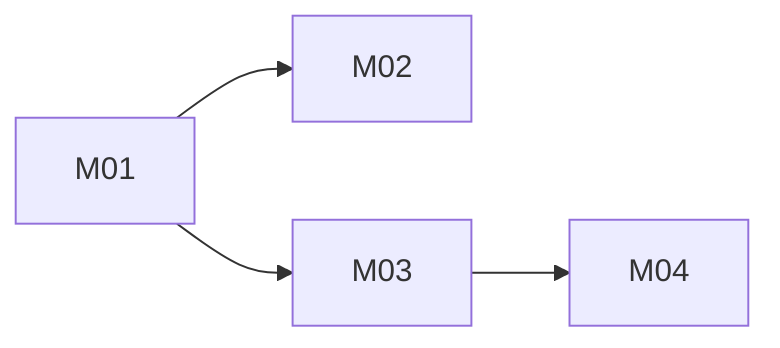

# arch-mind Build Plan

Baseline: RV-001
Change folders: docs/changes/; milestone folders are named YYYY-MM-DD-Mxx-<slug>

Milestone status (no status is stored in this plan):

```bash
grep -iH -m4 -E '^(Verdict|Acceptance|Verified by|Open limitations):' docs/changes/*-[Mm][0-9]*-*/verification.md
```

Changes since approval: the repository was not under version control when the design was approved, so later changes to `docs/product` and `docs/design` cannot be listed from git until it is. Once it is, use `git log -1 --format=%H -S'status: approved' -- docs/spec/manifest.yaml` and `git log --oneline <sha>.. -- docs/product docs/design`.

## Strategy
Four vertical slices, each usable on its own. The riskiest assumptions are proved first, in M01:
- a concept captured from Claude Code with the app closed is written by the shared rules module and then shown by the local server (ADR-001, ADR-003, ADR-004);
- the layer view with stacked bands fits the reference screen with real data (ADR-006, NFR-001);
- the local port rejects foreign Host and Origin (ADR-005).

M02 and M03 then grow capture and views independently; M04 adds review on top of the concept detail from M03.

## Architecture Proof Slice
Milestone: M01
Why this is the smallest useful end-to-end proof:
- It crosses every container in `architecture.dsl` once: capture server, rules module, concept files, local server, Study UI.
- It tests the one-way decisions early: the file format (ADR-002) and the language and shared rules module (ADR-004).
- It measures NFR-001 with the elkjs version the project pins, which discovery measured only with an older one.

## Dependency Graph


## Milestone M01 — A concept captured from Claude Code appears in the layer view

Goal:
With arch-mind closed, the author saves a complete concept (SEE-I, facets, one relation with a source, one recall question) through the capture plugin. Then the author starts the arch-mind command and sees that concept, and the concept it relates to, in the layer view, inside a 1366 px wide window.

Requirements:
- FR-001, FR-005, FR-033, FR-006, FR-009, FR-010, FR-011, FR-013, FR-014, FR-015, FR-019, FR-020
- NFR-001, NFR-003, NFR-004, NFR-005
- BR-001, BR-002, BR-003, BR-005
- CON-001, CON-002, CON-004, CON-005

Canonical authorities:
- `docs/design/domain.md`
- `docs/design/architecture/architecture.dsl`
- `docs/design/architecture/adr/` (ADR-001 to ADR-007)
- `docs/design/architecture/quality-attributes.md`
- `docs/design/data/concept.schema.json`, `docs/design/data/facets.schema.json`
- `docs/design/api/capture-tools.schema.json` (`list_concepts`, `save_concept`)
- `docs/design/api/openapi.yaml` (`GET /api/concepts`, `GET /api/facets`)
- `docs/design/ux/flows.mmd`

Prerequisites:
- None. The repository is created in this milestone (git initialized, work on a `feat/...` branch per the author's convention).

Expected create/edit areas (proposed, nothing exists yet):
- a shared rules package (parse, validate, serialize concept files; atomic write);
- the capture plugin (manifest, capture skill, stdio MCP server with `list_concepts` and `save_concept`);
- the local server (request guard, `GET /api/concepts`, `GET /api/facets`, static UI);
- the Study UI (layer view only: elkjs layout, React Flow drawing);
- workspace configuration (TypeScript, test runner, lint).

Acceptance:
- AC-001 — `save_concept` with a valid concept writes one Markdown file whose frontmatter and SEE-I headings match `concept.schema.json`; reading it back through the rules module returns an equal object.
- AC-002 — `save_concept` with a relation without a source, a relation to a missing concept, or an existing id writes nothing and returns a rejection whose `path` and `rule` name the problem (`missing_source`, `missing_target`, `duplicate_id`).
- AC-003 — The capture succeeds while the local server is not running.
- AC-004 — After starting the arch-mind command, the layer view shows the saved concepts in the bands of their layers, stacked client, network, server, data, with each relation drawn as an arrow labeled with its type.
- AC-005 — The TST-032 chain (13 concepts, 15 relations, entered as fixtures) renders as a layer view with no horizontal scrollbar in a 1366 × 768 window at 100 % zoom.
- AC-006 — A request to the local server with a foreign Host, or with a foreign Origin, is rejected; from another device on the network, no arch-mind port answers.
- AC-007 — A saved concept file opened in a plain text editor shows readable SEE-I, relations with sources and recall questions.

Tests:
- TST-001 — Rules module round trip: serialize then parse a concept with every optional field; objects are equal (AC-001).
- TST-002 — Rules module rejects each of: missing source, missing target, duplicate id, missing SEE-I part, no recall question, layer outside the fixed list; each rejection carries the expected `path` and `rule` (AC-002).
- TST-003 — Capture server contract test: drive the stdio server with `tools/list` and `tools/call` and validate every result against `capture-tools.schema.json` (AC-001, AC-002).
- TST-004 — Atomic write: interrupt a save between the temporary write and the rename; the store holds either the old file or the new one, never a partial file (NFR-003).
- TST-005 — Architecture rule "Only the rules module parses or validates concept files": a dependency check fails if any other package imports the YAML parser.
- TST-006 — Architecture rule "The Study UI and local server never write concept files": the local server has no write path to the concepts folder.
- TST-007 — Architecture rule "The local server listens on 127.0.0.1 and passes every request through the guard": requests with foreign Host and foreign Origin get 403; non-JSON bodies get 415 (AC-006).
- TST-008 — Layer view width: render the TST-032 fixture at 1366 px and assert no horizontal overflow (AC-005, NFR-001).

Quality gates:
- type check, lint and the test runner chosen in this milestone pass with no errors;
- `node <reviewing-system-design>/scripts/check-package.mjs .` still passes.

Completion evidence:
- test output for TST-001 to TST-008;
- a screenshot of the layer view with the TST-032 fixture at 1366 × 768;
- the saved concept file from AC-007;
- one interactive capture in a normal Claude Code session, noting whether `save_concept` asked for permission by default (open in `docs/discovery/findings.md` DQ-006).

Stop if:
- implementation requires changing a frozen product behavior;
- canonical authorities contradict each other;
- an unapproved architecture decision is required;
- required scope expands beyond this milestone;
- F-006 is still open when both processes need the store path: the single configuration source of the store folder must first be named in `architecture.dsl` through this milestone's change folder (Canonical Design Impact);
- PD-017 is still open and the capture flow needs to add new domains or concerns: keep the facet catalog read-only for capture, as designed;
- the author has not confirmed the store folder is backed up (human task from `quality-attributes.md` Operations), before the first real concept is captured.

## Milestone M02 — Claude proposes, the author builds the concept

Goal:
In a Claude Code session, Claude proposes candidate relations with sources, a SEE-I draft and recall questions; the author selects, explains, accepts or rewrites each, and saves. The author can later add relations, questions or an episode to an existing concept.

Requirements:
- FR-002, FR-003, FR-004, FR-007, FR-008, FR-012
- NFR-002
- BR-004

Canonical authorities:
- `docs/design/api/capture-tools.schema.json` (`get_concept`, `extend_concept`, rejection)
- `docs/design/ux/flows.mmd`
- `docs/design/data/concept.schema.json`
- `docs/design/architecture/adr/ADR-003-capture-path.md`

Prerequisites:
- M01

Expected create/edit areas (proposed):
- capture skill instructions (proposal and confirmation steps);
- capture server: `get_concept`, `extend_concept`;
- rules module: additive merge with duplicate-relation check.

Acceptance:
- AC-008 — During a capture, every proposed relation shows a type, a target and a source, and only the relations the author selected are saved, each with the author's explanation.
- AC-009 — A SEE-I part or recall question the author did not accept, edit or rewrite is not saved.
- AC-010 — `extend_concept` adds a relation, a recall question or an episode to an existing concept; new recall ids continue after the highest stored q-number and carry today's local date as `confirmed`; a duplicate (type, to) is rejected as `duplicate_relation`; fields outside the additive set are rejected.
- AC-011 — Over 5 real captures with up to 3 relations each, the tool adds at most 60 seconds of waiting and at most 2 confirmation prompts per capture, excluding the author's writing time (NFR-002).

Tests:
- TST-009 — Contract test for `get_concept` and `extend_concept` against `capture-tools.schema.json`, including `nothing_to_add`, `unknown_concept` and `duplicate_relation` rejections (AC-010).
- TST-010 — Rules module merge: extending never changes stored fields and assigns recall ids after the current highest (AC-010).
- TST-011 — Recorded skill walk-through: a scripted capture transcript where the author rejects one proposed relation and rewrites one SEE-I part; the saved file contains only what was confirmed (AC-008, AC-009).

Quality gates:
- type check, lint, tests pass; package check passes.

Completion evidence:
- test output for TST-009 to TST-011;
- a timing log of the 5 captures for AC-011.

Stop if:
- implementation requires changing a frozen product behavior;
- canonical authorities contradict each other;
- an unapproved architecture decision is required;
- required scope expands beyond this milestone;
- PD-017 is still open and the capture flow needs to add new domains or concerns.

## Milestone M03 — Study views over facet filters

Goal:
The author filters by domains, layers and concerns, follows chains in the layer view, checks every relation in the matrix view, sees sources and explanations on hover, opens a concept's detail, and sees hand edits and broken files reported.

Requirements:
- FR-016, FR-017, FR-018, FR-021, FR-022, FR-023, FR-024, FR-025
- UX-001, UX-003

Canonical authorities:
- `docs/design/api/openapi.yaml` (`GET /api/concepts`, `GET /api/concepts/{id}`, `GET /api/facets`)
- `docs/design/architecture/adr/ADR-006-layer-view-layout.md`
- `docs/design/domain.md` (View, Layer view, Matrix view, Reference screen)

Prerequisites:
- M01

Expected create/edit areas (proposed):
- Study UI: filters, matrix view, hover details, concept detail, problems list;
- local server: `GET /api/concepts/{id}`, problems in `GET /api/concepts`.

Acceptance:
- AC-012 — Any combination of domain, layer and concern filters selects exactly the matching concepts in both views.
- AC-013 — The matrix view shows matching concepts as rows and columns with the relation type in the source-row, target-column cell.
- AC-014 — Hovering or tapping a relation in either view shows its source and the author's explanation.
- AC-015 — When the matching concepts would not fit 1366 px wide, the app says so and suggests narrower filters instead of drawing a view that scrolls sideways.
- AC-016 — Selecting a concept opens its detail with SEE-I, relations with sources and explanations, episode, facets and the review state of each question.
- AC-017 — A hand edit to a concept file appears on the next load; a broken file is listed with its name and reason.

Tests:
- TST-012 — Filter selection unit tests over a fixture store (AC-012).
- TST-013 — Matrix rendering test on the TST-032 fixture (AC-013).
- TST-014 — Width guard: a fixture that cannot fit triggers the message, not a scrolling view (AC-015).
- TST-015 — API contract test for `GET /api/concepts/{id}` and the `problems` list against `openapi.yaml` (AC-016, AC-017).

Quality gates:
- type check, lint, tests pass; package check passes.

Completion evidence:
- test output for TST-012 to TST-015;
- screenshots of both views and the concept detail at 1366 × 768.

Stop if:
- implementation requires changing a frozen product behavior;
- canonical authorities contradict each other;
- an unapproved architecture decision is required;
- required scope expands beyond this milestone.

## Milestone M04 — Daily Leitner review

Goal:
The author opens the review screen, answers each due question from memory before seeing the answer, marks right or wrong, and the question moves between Leitner boxes. After a wrong answer the app offers the concept's detail. History is never rewritten.

Requirements:
- FR-026, FR-027, FR-028, FR-029, FR-030, FR-031, FR-032
- NFR-006
- BR-006, BR-007
- UX-002

Canonical authorities:
- `docs/design/api/openapi.yaml` (`GET /api/reviews/due`, `POST /api/reviews`)
- `docs/design/data/review-line.schema.json`, `docs/design/data/facets.schema.json`
- `docs/design/ux/review-flow.mmd`
- `docs/design/architecture/adr/ADR-002-storage-format.md`

Prerequisites:
- M03 (FR-031 opens the concept detail built there)

Expected create/edit areas (proposed):
- local server: Leitner scheduler, review endpoints, append-only log writer;
- Study UI: review screen.

Acceptance:
- AC-018 — The review screen lists the questions due on the current local day.
- AC-019 — The answer (SEE-I and explanations) stays hidden until the author reveals it, then the author marks right or wrong.
- AC-020 — A right answer moves the question up one box (stopping at the last) and sets the next due date by that box's interval; a wrong answer returns it to box 1; a new question is due the day after its `confirmed` day.
- AC-021 — After a wrong answer, the app offers the concept's detail.
- AC-022 — Each review appends one line to the log; no earlier line is ever changed.
- AC-023 — With 300 concepts, 600 questions and a year of review lines, the due list appears within 2 seconds of opening (NFR-006).

Tests:
- TST-016 — Architecture rule "Box and due date are never stored": scheduler tests replay known histories from `confirmed`, including a question with no reviews (AC-020).
- TST-017 — Architecture rule "The review log is only appended": the log writer opens the file in append mode only and a test asserts earlier lines are byte-identical after new reviews (AC-022).
- TST-018 — API contract test for the review endpoints against `openapi.yaml` (AC-018, AC-020).
- TST-019 — Load test with generated data for AC-023.
- TST-020 — UI test: the answer is not in the document before reveal (AC-019).

Quality gates:
- type check, lint, tests pass; package check passes.

Completion evidence:
- test output for TST-016 to TST-020, including the load-test timing.

Stop if:
- implementation requires changing a frozen product behavior;
- canonical authorities contradict each other;
- an unapproved architecture decision is required;
- required scope expands beyond this milestone;
- PD-016 is still open: read the box count and intervals from `facets.yaml`, never hard-code them;
- F-005 is still open when the scheduler compares dates: the day-boundary rule (local time zone, due date ≤ today) must first be stated in `domain.md` through this milestone's change folder;
- F-004 is still open when assigning recall ids after hand edits: either record the limitation as accepted or name the prevention rule in the design first.

## Requirement Coverage Matrix
| Requirement | Milestone(s) | Acceptance | Tests |
|---|---|---|---|
| FR-001 | M01 | AC-003 | TST-003 |
| FR-002 | M02 | AC-008 | TST-011 |
| FR-003 | M02 | AC-008 | TST-011 |
| FR-004 | M02 | AC-008 | TST-011 |
| FR-005 | M01 | AC-001 | TST-001, TST-002 |
| FR-033 | M01, M02 | AC-001, AC-009 | TST-002, TST-011 |
| FR-006 | M01 | AC-001, AC-002 | TST-002 |
| FR-007 | M02 | AC-010 | TST-009 |
| FR-008 | M02 | AC-009 | TST-011 |
| FR-009 | M01 | AC-002 | TST-002, TST-003 |
| FR-010 | M01 | AC-002 | TST-002, TST-003 |
| FR-011 | M01 | AC-002 | TST-002, TST-003 |
| FR-012 | M02 | AC-010 | TST-009, TST-010 |
| FR-013 | M01 | AC-003 | TST-003 |
| FR-014 | M01 | AC-007 | TST-001 |
| FR-015 | M01 | AC-004 | TST-006 |
| FR-016 | M03 | AC-017 | TST-015 |
| FR-017 | M03 | AC-017 | TST-015 |
| FR-018 | M03 | AC-012 | TST-012 |
| FR-019 | M01 | AC-004 | TST-008 |
| FR-020 | M01 | AC-004 | TST-008 |
| FR-021 | M03 | AC-014 | TST-013 |
| FR-022 | M03 | AC-013 | TST-013 |
| FR-023 | M03 | AC-015 | TST-014 |
| FR-024 | M03 | AC-016 | TST-015 |
| FR-025 | M03 | AC-016 | TST-015 |
| FR-026 | M04 | AC-018 | TST-018 |
| FR-027 | M04 | AC-019 | TST-020 |
| FR-028 | M04 | AC-020 | TST-016 |
| FR-029 | M04 | AC-020 | TST-016 |
| FR-030 | M04 | AC-020 | TST-016 |
| FR-031 | M04 | AC-021 | TST-020 |
| FR-032 | M04 | AC-022 | TST-017 |
| NFR-001 | M01, M03 | AC-005, AC-015 | TST-008, TST-014 |
| NFR-002 | M02 | AC-011 | timing log |
| NFR-003 | M01 | AC-001 | TST-004 |
| NFR-004 | M01 | AC-007 | TST-001 |
| NFR-005 | M01 | AC-006 | TST-007 |
| NFR-006 | M04 | AC-023 | TST-019 |
| BR-001 | M01 | AC-002 | TST-002 |
| BR-002 | M01 | AC-002 | TST-002 |
| BR-003 | M01 | AC-002 | TST-002 |
| BR-004 | M02 | AC-008, AC-009 | TST-011 |
| BR-005 | M01 | AC-002 | TST-002 |
| BR-006 | M04 | AC-020 | TST-016 |
| BR-007 | M04 | AC-022 | TST-017 |

## Deferred Scope
- Everything in PRD §12 Out and §14 Future Product Scope: phone or network access, focus view, FSRS, editing concepts inside the app, search.
- MINOR and NOTE findings F-007, F-008 and F-009 from `docs/design/review.md`, unless a milestone touches their artifact and the fix is one line.
