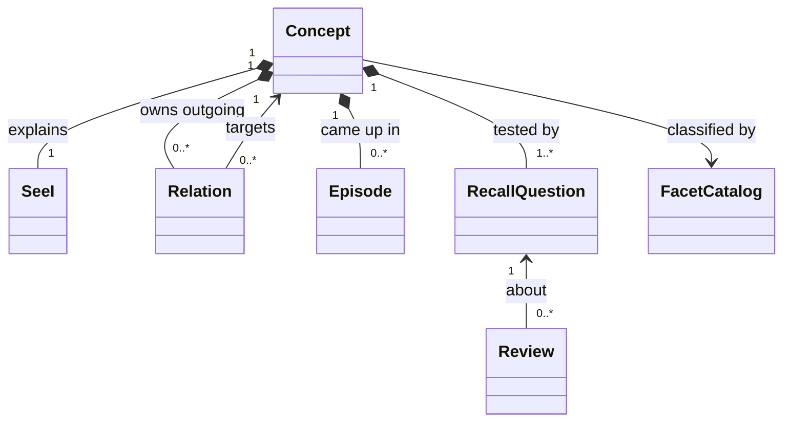
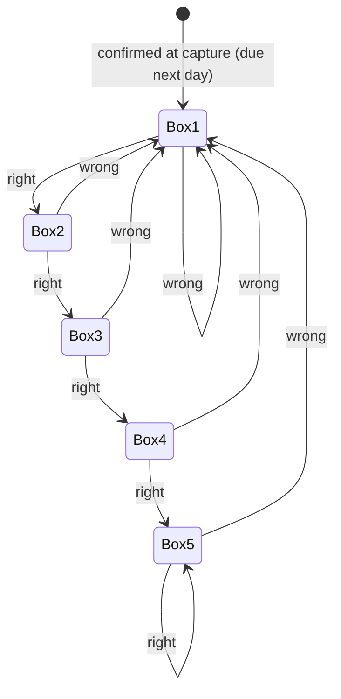
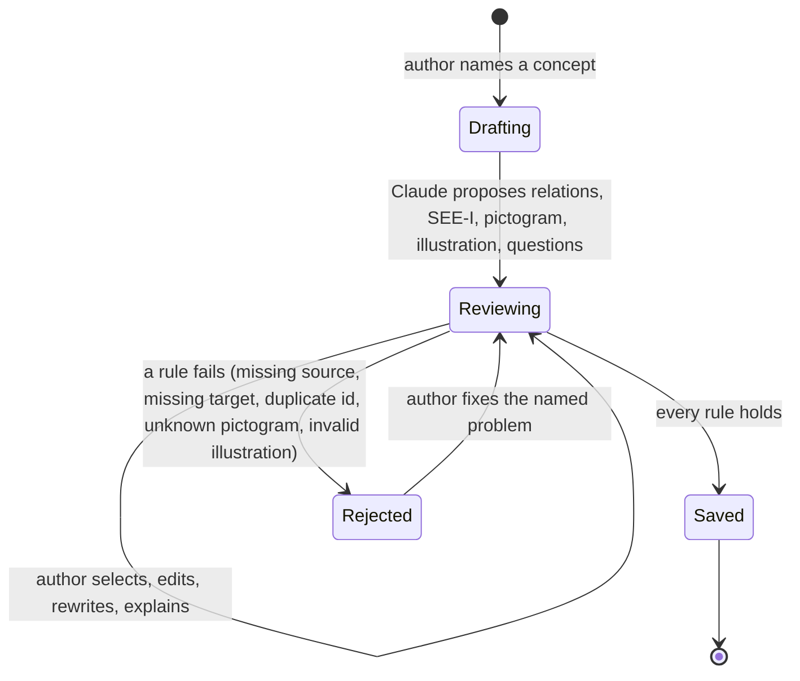

# Domain Model — arch-mind

## Ubiquitous Language
| Term | Definition | Related Requirements |
|---|---|---|
| Concept | One unit of architecture knowledge the author has captured, such as "Secure cookie attribute". Exists once. | FR-015, BR-002 |
| Relation | A typed, directed link from one concept to another, with a source and the author's explanation. | FR-002 to FR-004, BR-001 |
| Relation type | The verb of a relation, such as "requires", "complements", "alternative to". | FR-020, FR-022 |
| Source | The reference that backs a relation: official documentation, a specification, or an episode. | FR-009, BR-001 |
| Explanation | The author's one-sentence reason for a relation, in their own words. | FR-004 |
| SEE-I | The four-part explanation of a concept: statement, elaboration, example, illustration. Each part is approved by the author. | FR-005, FR-033, BR-005 |
| Episode | A real project situation where the concept came up, such as "TST-032 in the web project". | FR-007 |
| Facet | One independent axis for classifying concepts: layer, domain or concern. | FR-006, FR-018 |
| Layer | Where a concept lives in a system: client, network, server or data. Exactly one per concept. | BR-003, FR-019 |
| Layer plate | The surface that stands for one layer in the layer view; plates are stacked in the order client, network, server, data and carry the concepts of their layer. | FR-019, FR-037, UX-001 |
| Domain | The kind of product a concept belongs to, such as web, mobile or models. | FR-006 |
| Concern | The quality a concept serves, such as security or performance. | FR-006 |
| Capture | The act of turning a concept from a Claude Code session into a saved concept, through proposals the author reviews. | CAP-001 |
| Proposal | Something Claude suggests during a capture (a relation, a SEE-I part, a pictogram, a visual illustration, a recall question) that is not saved until the author confirms it. | FR-003, FR-008, FR-033, FR-034, FR-035, BR-004 |
| Pictogram | A small isometric picture that alludes to what a concept or a layer is. A concept has at most one, chosen from the pictogram library; it never replaces the name it stands for. | FR-034, FR-036, FR-038, BR-008, UX-004 |
| Pictogram library | The fixed set of pictograms shipped with the app, each with an id and a one-line meaning that capture offers to Claude. | FR-034, FR-038, BR-008 |
| Layer pictogram | The pictogram of a layer (client, network, server, data). Always in the library; shown on its plate and as the fallback for a concept without a pictogram or whose pictogram id is no longer in the library. | FR-037, FR-038 |
| Visual illustration | An optional drawing of what the SEE-I illustration part describes, kept as an image beside the text. A concept has at most one and is complete without it. | FR-035, FR-036, FR-025, BR-008, NFR-004 |
| Recall question | A question about a concept that the author answers from memory during review. | FR-008, FR-026 |
| Review | One attempt at a recall question on a given day, marked right or wrong by the author. | FR-027, FR-032 |
| Box | The Leitner level of a recall question; it sets how long until the question is due again. | FR-028 to FR-030, BR-006 |
| Due date | The day a recall question should next be reviewed. | FR-026, BR-006 |
| View | A filter over facets that selects concepts to draw. It is never stored as a copy of concepts. | FR-018, FR-015 |
| Layer view | A view that draws the matching concepts as pictograms on stacked layer plates with typed arrows, for following chains. | FR-019 to FR-021, FR-037 to FR-042 |
| Selection / neighbourhood | The selection is the one concept the author marked; its neighbourhood is the selected concept, its incoming and outgoing relations and the concepts they connect. Everything else recedes until the selection is cleared. | FR-039, FR-040, FR-041 |
| Focus | A state of the layer view in which only the selection's neighbourhood is drawn; leaving focus restores the filtered view. Choosing focus from a refused matrix opens the layer view focused. It is never stored. | FR-045, FR-047 |
| Group | The concepts on one plate that share a first listed domain, or the "No domain" group for concepts without one. Closed, it shows its domain and concept count; open, it shows its concepts. Only one group is open at a time, and a group that would not fit open stays closed. | FR-048, FR-049, BR-009 |
| Grouped layer view | The layer view drawn with one group per domain on each plate, chosen by the author when a view would not fit, also from a refused matrix; relations between groups appear as one directed connection per ordered pair, each with the number of relations it stands for when there are two or more (a single relation shows its type). | FR-047, FR-048 |
| Finder | A keyboard search over the titles and designators of every concept in the store that makes the chosen concept the selection and brings it into view; when the filters hide it, they are cleared. It does not search concept text. | FR-043 |
| Legend type filter | A relation type chosen in the wire legend: relations of that type stay prominent and the rest recede. With a selection, only what is both in the neighbourhood and of that type stays prominent. | FR-044, FR-039 |
| Matrix view | A view that draws concepts as rows and columns, with relation types in the cells. | FR-022 |
| Reference screen | A 1366 × 768 px desktop browser window at 100 % zoom; every view must fit its width. | NFR-001, FR-023 |

## Actors / Roles
- Author: the only human. Starts captures, confirms or rewrites every proposal, studies views, reviews questions, and may edit concept files by hand.
- Claude (in Claude Code): proposes relations, SEE-I drafts, a pictogram, a visual illustration and recall questions during a capture. Has no authority to save anything the author did not confirm.

## Core Concepts
### Concept
- Meaning: the unit of knowledge and the owner of everything said about it.
- Identity: a lowercase slug (for example `secure-attr`), chosen at first capture and never changed afterwards.
- Lifecycle: does not exist → saved (first capture) → extended (later captures add relations, questions, episodes, or a pictogram or illustration the concept lacks; hand edits change content). No deletion flow in the MVP.
- Invariants:
  - The identifier is unique across the store (BR-002).
  - Exactly one layer from the fixed list; any number of domains and concerns from the configured lists (BR-003, FR-006).
  - The order of its domains is meaningful: the first listed domain is its group in the grouped layer view (BR-009).
  - A complete SEE-I, each part approved by the author (BR-005).
  - At least one recall question (BR-005).
  - Owns its outgoing relations; incoming relations belong to their own source concepts.
  - At most one pictogram, from the pictogram library, and at most one visual illustration; both optional and approved by the author (BR-008, BR-004). Neither is needed for the concept to be complete.
  - Once a concept has a pictogram or an illustration, a capture does not replace it; a capture may add one only when the concept has none (FR-036). A hand-edited concept with more than one illustration link, or a link to a missing or invalid SVG, still loads without its illustration and is listed as a problem; a broken link still counts as an illustration already present, so a capture does not add another (ADR-009).

### Relation
- Meaning: a claim that one concept stands in a typed relation to another.
- Identity: no identity of its own; it is a value inside its source concept, distinguished by (type, target).
- Lifecycle: proposed → selected and explained → saved with its concept.
- Invariants:
  - Has a type, a target that is an existing concept, a non-empty source and an explanation (BR-001).
  - The target must exist when the relation is saved (FR-010).

### SEE-I
- Meaning: the concept explained in four parts.
- Identity: part of its concept.
- Lifecycle per part: drafted by Claude or written by the author → accepted, edited or rewritten by the author → saved (FR-005, FR-033).
- Invariants: all four parts present and approved before the concept is saved.

### Recall Question
- Meaning: a prompt that the author answers from memory.
- Identity: stable within its concept, so review history keeps pointing at it when its text is edited.
- Lifecycle: proposed → confirmed → in box 1, due the day after capture → moves between boxes with each review (FR-028 to FR-030).
- Invariants: exactly one box and one due date at any time (BR-006); both follow from its confirmation day, its review history and the box intervals. The confirmation day is recorded when the author confirms the question and never changes.
- Day rule: a day is a calendar day in the author's local time zone, for the confirmation day, the day of each review and every due date. A question is due when its due date is today or earlier, so a question left unreviewed stays due until answered.

### Review
- Meaning: a fact that the author answered a question on a day, right or wrong.
- Identity: the question plus the moment it was recorded.
- Lifecycle: recorded once; never edited or removed (BR-007).
- Invariants: refers to an existing recall question; its result is right or wrong.
- Day: counts for the local calendar day of the moment it was recorded; the next due date is counted from that day.

### Pictogram library
- Meaning: the fixed set of pictograms a concept can be given, with the layer pictograms among them.
- Invariants: the four layer pictograms (client, network, server, data) are always present (FR-037); a concept whose pictogram is missing or no longer in the library is shown with its layer pictogram, and a capture is never blocked for it (FR-038, PD-026). An unknown id in a hand-edited file is also listed as a problem with the reason (ADR-009). Membership is judged by the rules module, not the data schema.

### Facet catalog
- Meaning: the allowed values for each facet.
- Invariants: layers are fixed to client, network, server, data (BR-003). Who maintains domains and concerns is open (PRD PD-017).

## Relationships and Ownership

## State Transitions
### Recall question box

The number of boxes and their intervals are open (PRD PD-016); five boxes are drawn as the discovery example.

### Capture

## Domain Boundaries / Modules
- Knowledge: concepts, relations, SEE-I, episodes, pictogram ids, visual illustrations, recall question texts, the facet catalog and the pictogram library. The only owner of what is true about a concept.
- Capture: the proposal-and-confirmation workflow with Claude. Produces knowledge; owns nothing after the save.
- Study: reviews, boxes and due dates. Owns review history; reads recall questions from Knowledge.
- Views: layer view, matrix view, concept detail, and the selection that links them. Read-only over Knowledge and Study; the selection is transient and never stored.

## Cross-Boundary Rules
- Only Capture and the author's hand edits change Knowledge; Views and Study never change concepts.
- Study refers to recall questions by their stable identity, never by copying their text.
- Every rule of BR-001 to BR-005 and BR-008 is enforced wherever Knowledge is written, so Capture and hand edits are judged by the same rules; hand edits that break a rule are reported (FR-017), not silently accepted.
- Open: whether relation types come from a fixed list. The PRD does not fix one; the matrix view (FR-022) reads best with consistent types.
